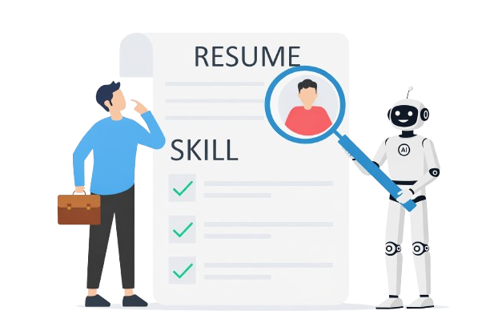

 
VivaAI

An AI-powered mock interview platform with a voice interviewer, resume analysis, timed answers, instant scoring and downloadable PDF reports.

Table of Contents

Introduction · Features · Tech Stack · Architecture · Folder Structure · Database Schema · API Documentation · Installation and Setup · Environment Variables · Technical Decisions · License and Contribution

Introduction

VivaAI is a full-stack MERN application that simulates a real interview. A candidate signs in with Google, picks a role, experience level and interview mode (Technical or HR), or uploads a resume and lets the AI extract those details.

The AI then generates five questions with rising difficulty. An on-screen interviewer asks them aloud, the candidate answers by voice or text within a time limit, and each answer is scored on confidence, communication and correctness. The result is a visual report with charts, question-wise feedback and a PDF download.

Features

Authentication

One-click Google sign-in through Firebase
JWT session stored in an httpOnly cookie (7-day expiry, SameSite=Strict)

Interview setup

Choose role, experience and mode (Technical or HR)
Optional PDF resume upload (up to 5 MB): role, experience, projects and skills are extracted automatically
Questions tailored to the role, experience, projects, skills and resume

Live interview

Five questions: 2 easy, 2 medium, 1 hard, with 60 / 60 / 90 / 90 / 120 second limits
AI interviewer video avatar that speaks each question (browser text-to-speech) with live subtitles
Answer by voice (speech-to-text with mic toggle) or by typing
Circular countdown timer; unanswered questions are auto-submitted when time runs out
Short spoken feedback after every answer

Reports and history

Scores out of 10 for confidence, communication and correctness
Overall performance ring, skill evaluation, performance trend chart and question breakdown
One-click PDF export
Interview history with a link to each past report
Tech Stack
Layer	Technology	Purpose
Frontend	React 19, Vite 8	UI and dev tooling
	Redux Toolkit, React Router 7	Session state and routing
	Tailwind CSS 4, Motion, react-icons	Styling and animation
	Recharts, react-circular-progressbar	Report charts and timer
	jsPDF, jspdf-autotable	Client-side PDF reports
	Firebase Auth, Axios	Google sign-in and REST calls
Backend	Node.js (ESM), Express 5	HTTP server and REST API
	Mongoose 9	MongoDB object modelling
	jsonwebtoken, cookie-parser, cors	Sessions and security basics
	Multer, pdfjs-dist	Resume upload and PDF text extraction
Services	MongoDB	Database
	OpenRouter (openai/gpt-4o-mini)	Question generation, resume parsing, answer scoring
	Web Speech API (browser)	Text-to-speech and speech recognition
Architecture
Backend (Express)
Frontend (React + Redux)
Google profile
REST + cookie
chat completions
Pages and components
Web Speech API
Firebase Auth
isAuth and Multer
Controllers
openRouter service
MongoDB
OpenRouter (GPT-4o-mini)

Answering a question

MongoDB
OpenRouter
Express API
Browser
Candidate
MongoDB
OpenRouter
Express API
Browser
Candidate
Speak the question (text-to-speech)
Answer by voice or text
POST /api/interview/submit-answer
Score confidence, communication, correctness
JSON scores and feedback
Save answer and scores
Short feedback
Speak the feedback

Interview lifecycle

Step	Client	Endpoint	What happens
1. Sign in	Google popup	POST /auth/google	User is created or found, cookie is set
2. Setup	Role, experience, mode (+ resume)	POST /interview/resume	PDF text extracted, AI returns structured profile
3. Questions	Start interview	POST /interview/generate-questions	5 questions generated and saved as a new interview
4. Answer	Voice or text, per question	POST /interview/submit-answer	Answer scored and feedback stored
5. Finish	After last question	POST /interview/finish	Averages calculated, interview marked completed
6. Review	Report or history page	GET /interview/report/:id	Full report loaded
Folder Structure
VivaAI/
├── client/
│   ├── public/                    # Static assets
│   └── src/
│       ├── assets/                # Images and videos/ (male-ai, female-ai)
│       ├── components/
│       │   ├── Interview.jsx      # Voice interview room, timer, mic, subtitles
│       │   ├── SetUp.jsx          # Role, experience, mode, resume upload
│       │   ├── Report.jsx         # Charts and PDF export
│       │   ├── Timer.jsx          # Circular countdown
│       │   └── AuthModel, Footer, Navbar
│       ├── pages/                 # Home, Auth, InterviewPage,
│       │                          # InterviewHistory, InterviewReport
│       ├── redux/                 # store, userSlice
│       ├── utils/firebase.js      # Firebase Auth and Google provider
│       ├── App.jsx                # Routes, current-user fetch, ServerUrl
│       └── main.jsx               # Entry point
└── server/
    ├── config/
    │   ├── connectDb.js           # MongoDB connection
    │   └── token.js               # JWT generation (7-day expiry)
    ├── controllers/
    │   ├── auth.controller.js     # googleAuth, logOut
    │   ├── user.controller.js     # getCurrentUser
    │   └── interview.controller.js# resume, questions, answers, reports
    ├── middlewares/
    │   ├── isAuth.js              # Verifies the JWT cookie
    │   └── multer.js              # Temp disk storage, 5 MB limit
    ├── models/                    # user, interview
    ├── routes/                    # auth, user, interview
    ├── services/openRouter.service.js  # LLM wrapper
    ├── public/                    # Temporary upload directory
    └── index.js                   # App entry point
Database Schema
takes
embeds
USER
INTERVIEW
QUESTION

User

Field	Type	Notes
name	String	Required, from Google profile
email	String	Required, unique

Interview

Field	Type	Notes
userId	ObjectId → User	Required
role	String	Required
experience	String	Required
mode	String	HR or Technical, required
resumeText	String	Extracted resume text, "None" if not provided
questions	[Question]	Embedded sub-documents
finalScore	Number	Average of question scores, default 0
status	String	Incompleted (default) or completed

Question (embedded in Interview)

Field	Type	Notes
question	String	Generated question text
difficulty	String	easy, medium or hard
timeLimit	Number	Seconds: 60, 60, 90, 90, 120
answer	String	Candidate's answer
feedback	String	Short AI feedback
score	Number	Overall score out of 10, default 0
confidence	Number	0 to 10, default 0
communication	Number	0 to 10, default 0
correctness	Number	0 to 10, default 0

Relationships: one user has many interviews, and each interview embeds its five questions, so a full interview loads in a single read. Both collections use timestamps (createdAt, updatedAt).

API Documentation

Base URL: http://localhost:8000/api Auth: /auth/google sets a token cookie. Every other route except /auth/logout requires it, so send credentials with each request (withCredentials: true in Axios).

Method	Endpoint	Description
POST	/auth/google	Sign in or sign up with a Google profile
GET	/auth/logout	Clear the auth cookie
GET	/user/current-user	Logged-in user
POST	/interview/resume	Upload a PDF resume (multipart) and extract a profile
POST	/interview/generate-questions	Create an interview with 5 questions
POST	/interview/submit-answer	Evaluate one answer
POST	/interview/finish	Finalize and return the score summary
GET	/interview/get-interview	Interview history for the current user
GET	/interview/report/:id	Detailed report for one interview
Examples

Google sign-in POST /auth/google

json
{ "name": "John Doe", "email": "john@example.com" }

200 OK

json
{
  "_id": "665f1c2e9b1d8a0012a4b7c1",
  "name": "John Doe",
  "email": "john@example.com",
  "createdAt": "2026-01-10T09:30:00.000Z",
  "updatedAt": "2026-01-10T09:30:00.000Z"
}

Analyze resume POST /interview/resume (multipart/form-data)

Field	Type	Required
resume	PDF file, max 5 MB	Yes

200 OK

json
{
  "role": "Full Stack Developer",
  "experience": "1 year",
  "projects": ["Chat App", "Mock Interview Platform"],
  "skills": ["React", "Node.js", "MongoDB"],
  "resumeText": "John Doe Full Stack Developer ..."
}

Error: 400 with "Resume required".

Generate questions POST /interview/generate-questions

json
{
  "role": "Full Stack Developer",
  "experience": "1 year",
  "mode": "Technical",
  "resumeText": "optional",
  "projects": ["optional"],
  "skills": ["optional"]
}

200 OK

jsonc
{
  "interviewId": "665f2a0b9b1d8a0012a4b7d4",
  "userName": "John Doe",
  "questions": [
    { "question": "Can you explain how you manage state in a large React application?", "difficulty": "easy", "timeLimit": 60 },
    { "question": "How would you design a REST API for a real-time chat feature?", "difficulty": "easy", "timeLimit": 60 }
    // ...3 more (medium, medium, hard)
  ]
}
Question	Difficulty	Time limit
1 and 2	easy	60 s
3 and 4	medium	90 s
5	hard	120 s

Errors: 400 "Role, Experience and Mode are required.", 404 "User not found.".

Submit an answer POST /interview/submit-answer

json
{
  "interviewId": "665f2a0b9b1d8a0012a4b7d4",
  "questionIndex": 0,
  "answer": "I use Redux Toolkit for shared state and local state for UI details.",
  "timeTaken": 42
}

200 OK

json
{ "feedback": "Clear explanation, but add a concrete example to strengthen your answer." }
Case	Score	Feedback
Empty answer	0	You did not submit an answer.
timeTaken above the time limit	0	Time limit exceeded. Answer not evaluated.
Otherwise	AI scores confidence, communication, correctness (0 to 10)	10 to 15 word AI feedback

Finish interview POST /interview/finish

json
{ "interviewId": "665f2a0b9b1d8a0012a4b7d4" }

200 OK

json
{
  "finalScore": 7.2,
  "confidence": 7.4,
  "communication": 7.8,
  "correctness": 6.4,
  "questionWiseScore": [
    {
      "question": "Can you explain how you manage state in a large React application?",
      "score": 8,
      "feedback": "Clear explanation, but add a concrete example to strengthen your answer.",
      "confidence": 8,
      "communication": 8,
      "correctness": 8
    }
  ]
}

Error: 400 "failed to find Interview".

History GET /interview/get-interview Returns 200 with an array (newest first) of { _id, role, experience, mode, finalScore, status, createdAt }.

Report GET /interview/report/:id Returns 200 with { finalScore, confidence, communication, correctness, questionWiseScore }, where questionWiseScore holds the full question objects. Error: 404 "Interview not found".

Auth errors (all protected routes)

Status	Body	Cause
400	{ "message": "user does not have a token" }	Missing cookie
400	{ "message": "isAuth error ..." }	Invalid or expired token
Installation and Setup
Prerequisites
Node.js 20.19+ (or 22.12+) and npm
MongoDB: local instance or a free MongoDB Atlas cluster
OpenRouter account and API key
Firebase project with Google sign-in enabled
Chrome or Edge for voice answers (speech recognition uses webkitSpeechRecognition)
Git
1. Clone the repository
bash
git clone <your-repo-url>
cd VivaAI
2. Server
bash
cd server
npm install
# create server/.env (see Environment Variables)
npm run dev          # nodemon, http://localhost:8000
3. Client

Open a second terminal:

bash
cd client
npm install
# create client/.env (see Environment Variables)
npm run dev          # Vite, http://localhost:5173
4. Try it

Open http://localhost:5173, sign in with Google, set up an interview and allow microphone access when asked.

Location	Script	Description
server	npm run dev	Start server with nodemon
client	npm run dev	Start Vite dev server
client	npm run build / preview	Production build and local preview
client	npm run lint	Run ESLint

Heads up: CORS allows only http://localhost:5173, and the API URL is hardcoded as ServerUrl in client/src/App.jsx. The Firebase project details in client/src/utils/firebase.js (except the API key) are also hardcoded, so replace them with your own Firebase project. Update all of these before deploying.

Troubleshooting
API calls failing → confirm PORT=8000 in server/.env.
Google popup fails → check that Google sign-in is enabled and localhost is in Firebase authorized domains.
Voice input not working → use Chrome or Edge and allow the microphone.
OpenRouter API Error → verify OPENROUTER_API_KEY and your OpenRouter credits.
Cookie not saved → use localhost for both apps (SameSite=Strict).
Environment Variables

Both .env files are already git-ignored.

server/.env

Variable	Required	Description	Example
PORT	Recommended	Server port. Use 8000 to match the client ServerUrl (defaults to 6000)	8000
MONGODB_URL	Yes	MongoDB connection string	mongodb://127.0.0.1:27017/vivaai
JWT_SECRET	Yes	Secret for signing JWTs, use a long random string	a1b2c3...
OPENROUTER_API_KEY	Yes	OpenRouter key used for all AI calls	sk-or-v1-...

client/.env

Variable	Required	Description	Example
VITE_FIREBASE_APIKEY	Yes	Firebase web API key for Google sign-in	AIza...
env
# server/.env
PORT=8000
MONGODB_URL=mongodb://127.0.0.1:27017/vivaai
JWT_SECRET=<random-string>
OPENROUTER_API_KEY=<openrouter-api-key>

# client/.env
VITE_FIREBASE_APIKEY=<firebase-web-api-key>

Generate a secret: node -e "console.log(require('crypto').randomBytes(32).toString('hex'))"

Technical Decisions
Decision	Why
Firebase Google sign-in + JWT httpOnly cookie	No passwords to store or reset, and the session token stays out of JavaScript reach
Browser Web Speech API for voice	Text-to-speech and speech recognition at zero server cost. The trade-off is Chrome or Edge for voice input, with typing as a fallback
Voice matched to the avatar	The interviewer video is male, so the app prefers a male browser voice and falls back to a female one
Single askAi() wrapper over OpenRouter	One place to change the model or provider. It also strips markdown code fences so JSON replies always parse
Strict JSON-only prompts with a scoring rubric	Predictable, parseable output for resume extraction and for confidence, communication and correctness scores
Fixed difficulty ramp and time limits	Easy to hard progression (60 to 120 s) simulates real interview pressure. Limits are stored per question and late answers score 0 on the server
10 to 15 word feedback	Short enough to be spoken naturally right after each answer
Questions embedded in the Interview document	One read loads a whole interview, and each answer is a single document save
Resume parsed on the server with pdfjs-dist	The AI receives clean text. The temp file is deleted after success and on failure
PDF report built in the browser (jsPDF)	No server load and no extra storage for generated files
Redux only for the user session	Interview state stays local to the components that use it, keeping the store small
License and Contribution
License

Released under the ISC License, as declared in the project's package.json. You may use, copy, modify and distribute the software freely, provided the copyright and permission notice is kept.
